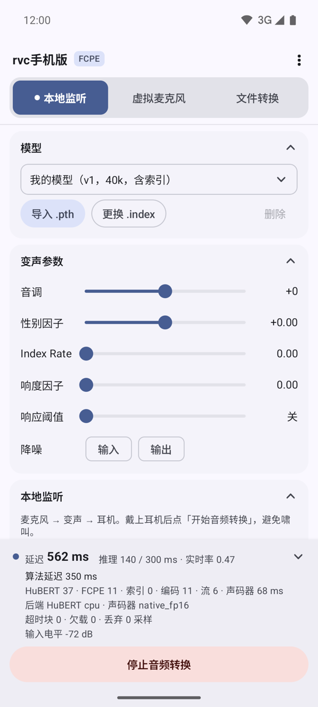
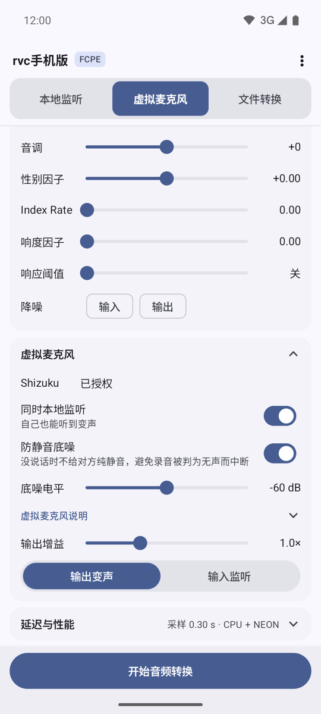
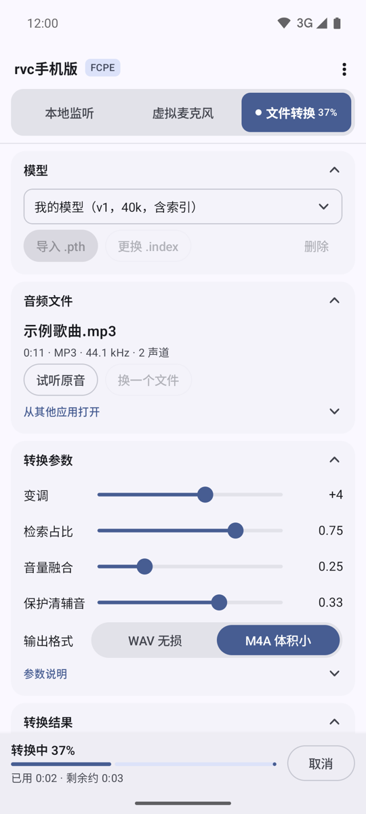
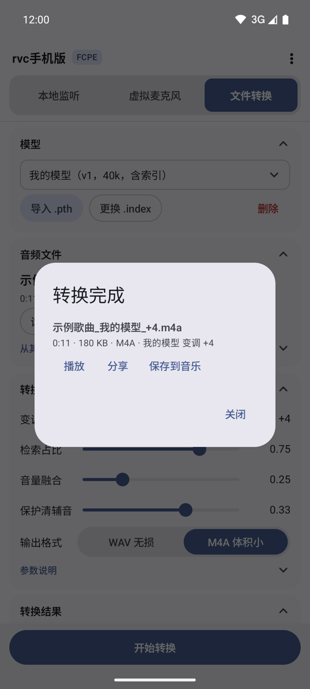

# Mobile RVC：Android 实时变声（FCPE）

在 Android 手机上运行 [RVC](https://github.com/RVC-Project/Retrieval-based-Voice-Conversion-WebUI) 的实时变声和音频文件变声。实时部分对应原版 `realtime_gui.py`，文件转换对应 WebUI 的「模型推理」（`infer/vc/pipeline.py`），音高算法固定为 FCPE：

- **直接导入原版 RVC 模型**：WebUI 导出的 `weights/*.pth`，加上可选的 `added_*.index`。手机上完成转换，不需要电脑。
- 支持 v1/v2、32k/40k/48k 全部标准结构，以及多说话人模型。
- **在线模型库**：「导入 .pth」→「打开在线模型库」，搜索并浏览魔搭社区（modelscope.cn，国内可直接访问）上的 RVC 模型，点「下载」自动下载 .pth 和对应索引并导入。
- 参数和原版界面一致：响应阈值、音调、性别因子（共振峰）、Index Rate、响度因子、采样长度、淡入淡出、额外推理时长、输入降噪、输出降噪、输入监听/输出变声。
- 三种工作模式，对应界面最上方的三个标签
  - **本地监听**：麦克风 → 变声 → 耳机（AAudio 低延迟）。
  - **虚拟麦克风（Shizuku）**：拦截其他应用（微信、QQ、Discord、游戏等）的录音，换成变声后的声音。
  - **文件转换**：把歌曲、录音或视频里的声音整段变声，导出 WAV 或 M4A。可以在 App 里选文件，也可以在其他应用里对音频选「用其他应用打开 / 分享」→「用 rvc手机版 变声」。
- 计算后端：CPU（自研 NEON fp16 声码器 + ONNX Runtime）、GPU（ORT WebGPU/Vulkan）、NPU（骁龙 HTP / QNN，`qnn` 变体）、NNAPI。

## 截图

<table>
  <tr>
    <td align="center"><br>本地监听（运行中）</td>
    <td align="center"><br>虚拟麦克风</td>
    <td align="center"><br>文件转换（转换中）</td>
    <td align="center"><br>转换完成</td>
  </tr>
</table>

最上方三个标签切换模式：选中的标签是实心的，正在运行的模式前有圆点，文件转换时显示进度百分比。开始 / 停止和运行状态固定在底部。

## 工作原理

```
麦克风 48k ─► [阈值门限] ─► [输入降噪] ─► 重采样 16k ─┬─► HuBERT/ContentVec (v1: 9层+proj / v2: 12层)
                                                      │        └─► 索引检索 (IVF-Flat, 1/d² 加权)
                                                      └─► FCPE (STFT 原生, 网络 ONNX) ─► 音高缓存
  enc_p ─► z_p = m + e^logs·ε·0.66666 ─► flow⁻¹ ─► NSF 正弦源(原生) ─► NSF-HiFiGAN 声码器
  ─► [共振峰重采样] ─► 重采样 48k ─► [输出降噪] ─► 响度混合 ─► SOLA 拼接 ─► 输出
```

C++ 引擎（`android/app/src/main/cpp/engine/rvc_engine.cpp`）逐行移植自 RVC 的 `realtime_gui.py` 的 `audio_callback` 和 `infer/rtrvc.py`。分块方式、`skip_head` / `return_length`、音高缓存、SOLA、RMS 混合、TorchGate 降噪都和原版一致。

### 怎样直接使用原版 .pth

- `tools/rvc_mobile/export_synth.py` 为每种标准结构导出只含图、不含权重的 ONNX 模板（enc_p / flow / dec）。
- 图里的每个参数都以 `.pth` 中的原始名字和原始 fp16 数值作为外部初始化器。weight-norm 等变换写成图节点，由 ONNX Runtime 在加载时做常量折叠。
- 所以手机端导入时只需按清单把 `.pth` 里的张量字节拷进 `weights.bin`。负责这一步的是 `pth_reader.cpp`：用 C++ 实现了 zip 和 pickle 的解析，不依赖 Python。
- faiss 索引由 `ivf_index.cpp` 解析，转成紧凑格式（fp16 向量）。

## 手机端优化

| 优化 | 说明 |
|---|---|
| 自研 NEON fp16 声码器 | 声码器占整体约 80% 的计算量（40k 模型每秒音频约 90 GFLOP）。ORT 的 CPU 后端只有 fp32 卷积，所以自己实现了多抽头卷积内核：ARMv8.2 fp16 FMA，一次 8 路，每 64 项刷新到 fp32 累加以保证精度。转置卷积和带步长的噪声卷积都改写成多相形式，复用同一个内核。运行时检测 asimdhp，不支持时退回 fp32 NEON。 |
| GPU（WebGPU/Vulkan） | `onnxruntime-android` 1.32 自带 WebGPU EP。HuBERT 和声码器都能放到 GPU 上，加速器后端固定张量形状。 |
| NPU（QNN HTP） | `qnn` 变体内置 QNN 2.42 运行库（HTP V68–V81），使用 fp16 精度。编译好的上下文缓存到 `cache/accel_cache`（按图、权重和精度区分），第二次启动不用重新编译。声码器图里不含"单输入通道"的卷积：谐波源上的 4 个噪声卷积写成等价的多相 3 抽头卷积和逐通道乘加，说话人条件写成矩阵乘（它们是图里仅有的非常规卷积，骁龙 8s Gen 3 的 NPU 校验就是在这里失败的；而 ONNX Runtime 里一个卷积被拒，整个会话就建不起来）。加速器仍然跑不了声码器时，退回原生 NEON 声码器而不是 ORT 的 CPU 实现（后者慢数倍），并把加速器给出的原因连同日志显示出来。 |
| 并行与调度 | FCPE 和 HuBERT 并行执行；计算线程绑定大核（按 cpufreq 识别）；音频线程提到 -19 优先级。Android 13+ 通过 ADPF（PerformanceHint）上报每块耗时，帮助调度器提频。 |
| 实时驱动 | AAudio 独占低延迟流，配合无锁环形缓冲。积压超过上限时丢弃以控制延迟。 |
| 降噪 | TorchGate 移植到 C++，非 2 的幂长度的 FFT 用 Bluestein 算法。 |
| 音频流自恢复 | 切换应用、插拔耳机、系统音频服务重启都会让音频流失效，而且待命中（已停止）的流失效时系统不会通知。所以：启动采集流时检查结果，起不来就换一条新的；运行中 0.5 秒收不到麦克风数据就重建采集流，监听输出同理；注入轨道被系统重建后会停在"等待填满"状态，检测到播放位置不动就重新填满；Shizuku 端服务进程被清理时自动重新启动。状态栏会直接提示"没有收到麦克风数据""采集到的是纯静音""对方应用的录音被系统静音"。 |

### 文件转换原理

逐步移植自 WebUI「模型推理」的 `vc_single` 和 `Pipeline.pipeline`（`android/app/src/main/cpp/engine/offline.cpp`）：

```
文件 ─► 系统解码器（MediaExtractor / MediaCodec）─► 单声道 16k ─► 峰值限制到 0.95 ─► 48 Hz 高通（filtfilt）
  ─► 在每 x_center 秒附近找最安静的 10 ms 作切点 ─► 两端各反射填充 x_pad 秒 ─► 整段 FCPE（未发声帧插值、变调）
  ─► 逐段：HuBERT ─► 索引检索 ─► 保护清辅音 ─► enc_p / flow⁻¹ / NSF-HiFiGAN ─► 去掉两端填充 ─► 拼接
  ─► 音量包络融合（半秒 RMS）─► 超过 0.99 时整体缩小 ─► WAV（模型采样率）或 M4A（AAC）
```

- 参数和默认值与 WebUI 相同：变调、检索特征占比 0.75、音量包络融合 0.25、保护清辅音 0.33。
- 和 PC 的差别只在内存：分段更短（`x_pad/x_query/x_center/x_max` = 1/4/12/14 秒，PC 的 CPU 配置是 1/6/38/41；RVC 本身也按显存大小选这组值）；声码器分成 256 帧一块、两侧各多算 24 帧（感受野约 12 帧），结果与整段解码逐位相同；5 分钟以上的文件 FCPE 分成 2 分钟一块。
- 文件转换使用 ORT CPU（任意长度）和原生 NEON 声码器；用的是「延迟与性能」里的 CPU 线程数和 FP16 设置。转换时实时引擎的模型会被释放，下次开始实时变声时自动重新加载。
- 转换在前台服务里进行，可以锁屏或切到别的应用，通知栏显示进度并可取消。结果保存在 App 内，可以试听、分享给其他应用，或保存到「音乐/RVC」。

### 虚拟麦克风原理（Shizuku）

`ShellAudioService` 通过 Shizuku 以 shell 身份（uid 2000）运行，有 `MODIFY_AUDIO_ROUTING`、`CAPTURE_AUDIO_OUTPUT`、`RECORD_AUDIO` 权限。

1. **注入**：注册 AudioPolicy 回环混音（`MIX_TYPE_RECORDERS` + `ROUTE_FLAG_LOOP_BACK`）。其他应用用 MIC、VOICE_COMMUNICATION、CAMCORDER、VOICE_RECOGNITION、UNPROCESSED 这几个录音源录音时，实际读到的是我们注入的变声音频。
2. **按需采集**：平时不录音。监测到有应用开始录音后，才开始采集真实麦克风。
   - 背景：Android 不允许两个普通录音同时进行，后启动的一方会把另一方静音（AOSP `AudioPolicyService::updateUidStates_l`）。
   - **语音消息类**（MIC 源，比如微信按住说话）：由 App 自己采集。App 开启了「RVC 虚拟麦克风」无障碍服务，无障碍应用的录音不受上面这条规则限制。
   - **通话类**（VOICE_COMMUNICATION 等隐私源）：由 shell 端采集，靠的是 `CAPTURE_AUDIO_OUTPUT` 权限。
   - 如果检测到我方采集被系统静音，会自动切换到另一条路径。
   - 无障碍服务由 shell 端通过 `settings put secure` 自动开启。它不读取屏幕内容，也不执行任何操作。
3. **唤醒和防漏音**：
   - 待命时持续给注入轨道写少量静音。否则注入通道会被系统判为不可用，新录音会先被接到真实麦克风上，漏出本音。启动时和每次录音结束后还要先把轨道的缓冲写满一次：流式 AudioTrack 在缓冲第一次填满之前不算开始播放，只靠几毫秒的补写永远填不满，开始后的第一次录音就会先接到真实麦克风约半秒。
   - **防静音底噪**：真实麦克风不会给出纯数字静音，很多应用把一串全零采样当成"麦克风被占用 / 没有权限"，直接结束录音。而变声流在两种情况下恰好是全零：每次录音开头第一块还没算出来的那段；以及开了响应阈值或降噪、人又没说话的时候（响度被压到零）。所以注入的音频里始终垫着一层相当于安静房间的底噪（粉噪，默认 −60 dBFS，可调可关），只进注入通道，不进本地监听。
   - 每次录音结束后，丢掉还没播出的音频，并用一次 250ms 的短录音把系统 Submix 管道里残留的旧音频读掉，避免下一次录音开头听到上一段。
   - 有应用开始录音时，通过录音状态回调立即响应；采集流事先建好，触发时只需启动。等第一块音频凑齐的这段时间里，先空跑一次推理来预热。
   - 从对方开始录音到收到变声，约等于采样长度 + 一次推理 + 约 100ms 系统缓冲（模拟器实测：采样长度 0.30 秒时约 600ms，0.15 秒时约 435ms）。

推理始终在 App 进程里进行。shell 端和 App 之间用两条管道传 float32 PCM。

## 验证结果

所有对比都在确定性模式下进行（噪声置零），参考是 RVC 原版代码（`infer/rtrvc.py` 加上 `realtime_gui.py` 的回调逻辑），测试模型为 v1 40k + 索引：

| 对比项 | 结果 |
|---|---|
| ONNX 合成器 vs RVC PyTorch（enc_p / flow / dec，多种长度） | 相对误差 ≤1.2e-5 |
| ONNX HuBERT vs Transformers（v1 / v2） | 相对误差 ≤4e-5 |
| ONNX FCPE vs torchfcpe | 最大 0.012 音分，清浊判断完全一致 |
| C++ 导入器 vs Python（weights.bin / index.bin） | 逐字节相同 |
| C++ 实时引擎 vs RVC 原版实时（默认参数） | SNR 80.6 dB |
| 同上，开启索引 0.6 + 升调 4 + 共振峰 2 + 门限 -45 + 响度 0.3 | SNR 78.3 dB |
| 同上，开启输入降噪 + 输出降噪 | SNR 64.1 dB |
| C++ TorchGate vs PyTorch（48k / 44.1k） | SNR 133 dB |
| 原生声码器 fp32 / fp16 vs ORT fp32 | 117 dB / 54.6 dB |
| 虚拟麦克风注入（Android 16 模拟器，uid 2000） | 用 MIC 源录音的应用收到 440 Hz 注入信号，真实麦克风同时正常采集 |
| 文件转换 vs RVC 原版 `Pipeline.pipeline`（11 秒，单段，变调 4 + 索引 0.75 + 包络 0.25 + 保护 0.33，原生 fp32 声码器） | SNR 69.2 dB，长度相同 |
| 同上，默认的 fp16 声码器 | SNR 53.8 dB |
| 同上，68 秒、6 段（切点与原版一致） | SNR 52.2 dB，长度相同 |
| 文件转换：声码器分块 vs 整段解码 | 逐位相同 |
| 流式重采样 vs 整段重采样（44.1k / 22.05k / 8k / 96k 等 → 48k / 16k） | 逐位相同 |

## 性能（实测）

> 目前**只在 arm64 模拟器上实测过**。模拟器跑在 Apple M6 主机上（2 个性能核 + 4 个能效核，模拟器配 6 个 vCPU）。**还没有在真实手机上跑过**。

测试条件：v1 40k 模型 + 索引，采样长度 0.3 s，额外推理时长 0.5 s。下表为每 300 ms 一块的平均处理时间（越低越好，必须低于 300 ms 才能实时）：

| 配置 | 每块耗时 | 实时率 |
|---|---|---|
| 全部用 ORT CPU（4 线程） | 224 ms | 0.75 |
| 原生 fp32 声码器 | 161 ms | 0.54 |
| **原生 fp16 声码器（默认）** | 119 ms | **0.40** |
| HuBERT + 声码器都用 WebGPU（主机 GPU 经模拟器转译） | 41 ms | 0.135 |

- App 内实时运行（本地模式和管道模式）：0 块超时、0 欠载。
- 文件转换（同一模拟器）：11 秒的歌约 3 秒；5 分钟的 mp3 → m4a 约 90 秒（处理时间 / 音频时长 0.30），进程内存峰值约 1.0 GB（实时模式约 0.64 GB）。
- 手机能否实时，取决于大核的 NEON fp16 算力或 GPU/NPU。2024–2026 年的旗舰平台（骁龙 8 Gen 3 / 8 Elite / 8 Elite Gen 5、天玑 9300 / 9400 / 9500 等）按算力估计，默认 CPU 配置应该能实时，但这只是估计。
- 不够快时可以：
  - 在 App 里点“性能测试”看实际耗时；
  - 把声码器切到 GPU 或 NPU（骁龙机型用 `qnn` 包）；
  - 增大采样长度、减小额外推理时长。

## 构建

依赖：Android SDK（compileSdk 37）、NDK 29、CMake 3.31、JDK 17+、Python 3.10–3.12（只用于导出基础模型）。

```bash
cd tools
python3 -m venv .venv && . .venv/bin/activate && pip install -r requirements.txt
```

生成基础模型（会下载 RVC 的 hubert_base，产物在 `build/apk_assets/rvc`，约 231 MB）：

```bash
PYTHON=.venv/bin/python ./build_assets.sh
```

编译 APK。通用版（CPU / WebGPU / NNAPI / XNNPACK）：

```bash
cd ../android && ./gradlew :app:assembleStandardRelease
```

骁龙 NPU 版：

```bash
./gradlew :app:assembleQnnRelease
```

不打包模型的 APK 也能装。之后在 App 里导入基础模型包（`MAKE_ZIP=1 ./build_assets.sh` 会生成 `build/apk_assets/rvc_base_pack.zip`）。

### 命令行工具（开发调试）

`rvc_cli` 用同一份引擎代码，可以在电脑或 `adb shell` 上运行：

- `import` / `process`：导入模型、用实时引擎逐块处理 wav；
- `convert`：App 的文件转换（任意音视频 → wav / m4a，参数如 `pitch=4 index_rate=0.75 deterministic=true`）；`probe`：查看文件的音轨；`restest`：流式重采样自检；
- `bench`：基准测试；
- `pipetest`：管道模式实时测试；
- `dectest` / `hubtest`：对比加速器后端的精度与速度；
- `gatetest`：降噪对比。

Android 版的编译方式见 `android/app/src/main/cpp/CMakeLists.txt`。

不安装 Shizuku 也能检查虚拟麦克风链路：

```bash
adb shell 'CLASSPATH=$(pm path com.mobilervc | cut -d: -f2) app_process /system/bin com.mobilervc.shizuku.ShellSelfTest'
```

## 使用

1. 导入模型，两种方式：
   - 在 App 里点“导入 .pth”，选择 RVC 导出的推理模型，再选一个 `added_*.index`（可选）。
   - 在 QQ、微信或文件管理器里，对 `.pth` / `.index` 选“用其他应用打开”或“分享”，再选“导入到 rvc手机版”。`.pth` 和 `.index` 可以一起分享。只收到 `.index` 时，App 会让你选择把它添加到哪个已有模型。
2. 调整参数。常规设置可以实时调；性能设置要停止后重新开始才生效。
3. 在最上方的标签里选择模式（选中的标签是实心的；正在运行的模式前有圆点，文件转换时显示百分比）：
   - **本地监听**：戴上耳机后点“开始音频转换”。
   - **虚拟麦克风**：先安装并启动 Shizuku，在 App 里授权，再点“开始音频转换”。之后 App 处于待命状态，微信、QQ 等应用一开始录音就会自动变声（开头约 0.5 秒没有人声，只有底噪）。如果对方应用一录音就自己停掉，把"防静音底噪"的电平调大一些再试。
   - **文件转换**：点“选择音频文件”，或在其他应用里对音频选「用其他应用打开 / 分享」→「用 rvc手机版 变声」（会自动切到这个标签并载入文件）；调好变调等参数后点底部的“开始转换”。完成后可以播放、分享、保存到「音乐/RVC」。实时变声运行时不能转换文件，底部会给出“停止实时变声”按钮。
4. 开始 / 停止按钮和运行状态固定在屏幕底部，标签和加载进度固定在顶部，设置滚到哪里都看得到。底部状态一行显示估计延迟、推理时间和实时率，点一下展开各阶段耗时、超时块数。
5. 各组设置点标题可以折叠，折叠后标题右侧显示当前值的摘要；折叠状态会记住。

## 目录结构

```
android/                 Android 工程（Kotlin + C++）
  app/src/main/cpp/engine/   平台无关的 C++ 引擎：pth/faiss 解析、DSP、ORT、原生声码器、降噪、文件转换（offline.cpp）
  app/src/main/cpp/android/  AAudio 实时驱动、JNI、音视频解码 / 编码（offline_file.cpp）
  app/src/main/java/...      Compose 界面、前台服务、Shizuku 桥接、shell 端音频服务
tools/                   模型导出和桌面参考实现（Python）
  rvc_mobile/rt_pipeline.py  引擎的可执行规格（numpy + ORT），C++ 按它移植
build/                   生成物（已忽略）
```

## 已知限制

- 只支持带音高（f0=1）的模型，不支持 nono 模型。非标准结构需要在电脑上运行 `export_synth.py --pth` 生成模板。
- 不同机型的虚拟麦克风行为可能不同（厂商可能改过音频策略）。部分系统会限制侧载应用的无障碍服务，这时需要在系统设置里手动开启「RVC 虚拟麦克风」。
- 我方开始采集后，个别应用可能通过系统录音回调发现“另一路录音”。按需采集已经把这段时间压缩到对方录音期间。
- 不 root 就无法直接改写其他应用进程里的音频数据。AudioPolicy 重定向是不 root 时唯一可行的替代办法。
- QNN / NNAPI / WebGPU 没有系统地在真机上验证过，不同芯片的 NPU 支持的算子不一样。加速器初始化失败时自动退回 CPU（声码器退回原生 NEON），界面会给出原因，可以点"复制"把完整信息发出来。
- 模型导入时会把当时的计算图复制到模型目录。应用更新带来新图时，只要权重布局没变，加载时会自动换成新图，不需要重新导入。
- ORT 的 fp16 计算图在 WebGPU 上精度不足，所以所有加速器都用 fp32 图，由 EP 自己选择精度。
- 文件转换：
  - 微信 / QQ 的语音消息是 SILK 编码，系统解码器不支持，需要先转成 mp3 / m4a / wav（App 会识别并提示）。能解码哪些格式取决于手机系统（一般包括 mp3、aac/m4a、flac、ogg/opus、wav、amr 和常见视频的音轨）。
  - 输出单声道，和 RVC 相同。只有 RVC「模型推理」里的参数；性别因子、响应阈值、降噪是实时模式的功能，不用于文件转换。
  - 只用 CPU：加速器要求固定的张量形状，而每段长度都不同。
  - 输出 m4a 时，40 kHz 的模型会重采样到 48 kHz（AAC 没有 40 kHz）。

## 许可

本项目以 [MIT 许可](LICENSE) 发布。代码参考并移植自 RVC-Project/Retrieval-based-Voice-Conversion-WebUI、CNChTu/FCPE（torchfcpe）、TorchGate（均为 MIT）；依赖 ONNX Runtime（MIT）、Shizuku API（Apache-2.0）、HiddenApiBypass（Apache-2.0）。上游版权声明与许可全文见 [THIRD_PARTY_NOTICES.md](THIRD_PARTY_NOTICES.md)。
